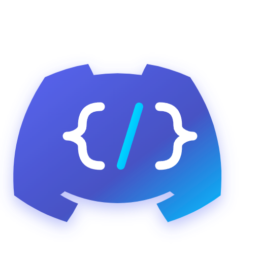
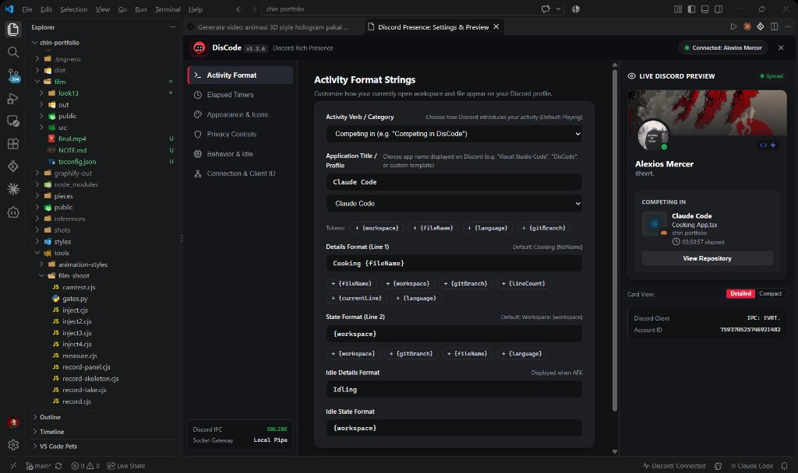
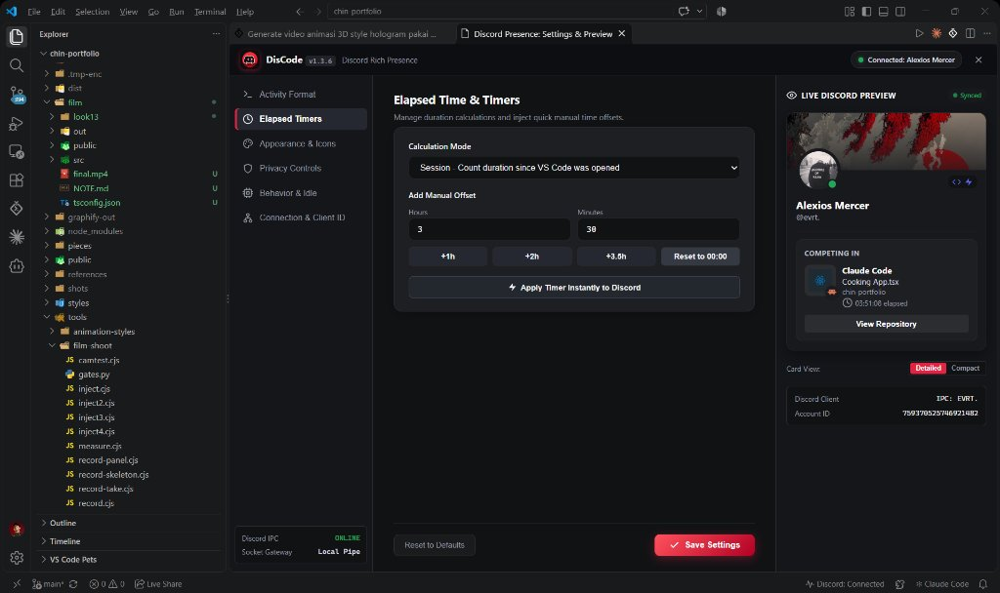
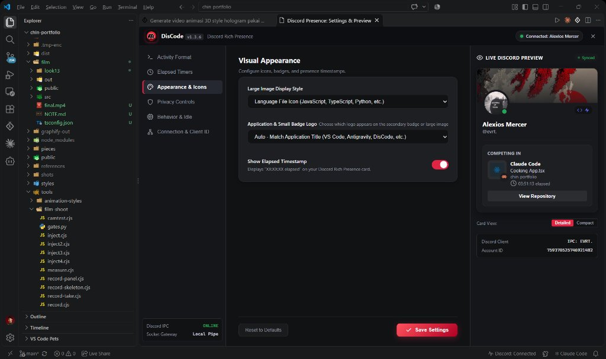
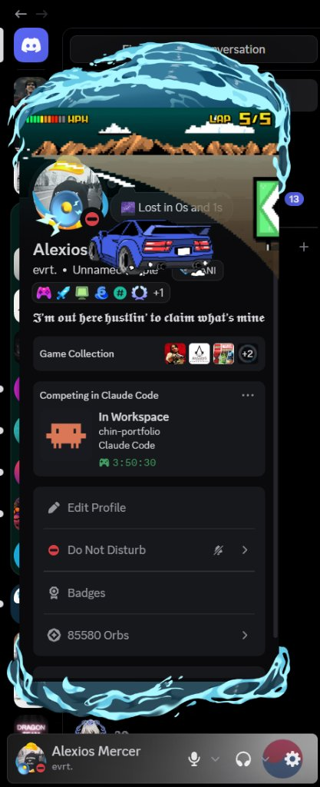
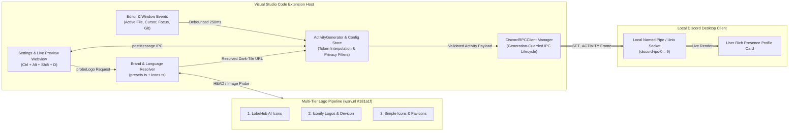

<div align="center">

  

  # DisCode — Discord Rich Presence for VS Code

  **Next-generation, sub-second Discord Rich Presence engine for Visual Studio Code with an interactive live-preview dashboard, 24+ AI coding agent presets, and a universal 3,500+ brand logo resolver.**

  <p align="center">
    <a href="https://github.com/UnnamedPeople-Chin/discode/releases">
      
    </a>
    <a href="https://code.visualstudio.com/">
      
    </a>
    <a href="https://www.typescriptlang.org/">
      
    </a>
    <a href="https://discord.com/developers/docs/topics/rpc">
      
    </a>
    <a href="https://esbuild.github.io/">
      
    </a>
    <a href="LICENSE">
      
    </a>
  </p>

  <p align="center">
    <a href="#-executive-summary">Executive Summary</a> •
    <a href="#-visual-previews">Visual Previews</a> •
    <a href="#-key-features">Key Features</a> •
    <a href="#-system-architecture--tech-stack">Architecture & Stack</a> •
    <a href="#-project-directory-structure">Directory Structure</a> •
    <a href="#-getting-started--setup-guide">Getting Started</a> •
    <a href="#-team--credits">Credits</a>
  </p>

  <br />
  

</div>

---

## 📌 Executive Summary

Legacy Discord Rich Presence extensions for VS Code force developers to edit raw `settings.json` files blindly, suffer from stale IPC socket freezes when Discord restarts, and lock users into a single hardcoded application identity. Furthermore, with the rise of modern AI coding agents (**Claude Code**, **Cursor**, **Antigravity**, **Windsurf**, **Codex**, **Gemini CLI**), developers lacked a native way to showcase their true AI-assisted workflow with authentic, dark-padded brand iconography on Discord.

**DisCode** solves these challenges by combining a **non-blocking, sub-second Local IPC Socket Engine** with a **Cyber-Ronin Visual Settings & Live Preview Dashboard** directly inside VS Code (`Ctrl + Alt + Shift + D`). Every change to activity verbs (`Playing`, `Listening to`, `Watching`, `Competing in`), dynamic workspace tokens, elapsed timer offsets, or custom application titles is rendered in real time on an authentic Discord profile card simulator and pushed to the local Discord client in under 250ms—with **zero external telemetry** and **zero editor lag**.

---

## 🖼️ Visual Previews

<table>
  <tr>
    <td width="50%" align="center">
      
      <br />
      <em><b>1. Activity Format & AI Agent Presets</b> — Customize activity verbs, pick from 24+ AI coding agents (e.g. Claude Code), inject dynamic tokens with one click, and inspect the live Discord card preview.</em>
    </td>
    <td width="50%" align="center">
      
      <br />
      <em><b>2. Elapsed Timers & Manual Offset Engine</b> — Switch between Session, File, or Manual duration tracking, inject custom hour/minute offsets (+1h, +2h, +3.5h), and sync to Discord instantly.</em>
    </td>
  </tr>
  <tr>
    <td width="50%" align="center">
      
      <br />
      <em><b>3. Appearance & Icons Configuration</b> — Configure primary/secondary image styles, automatic application badge matching, and toggle live elapsed timestamps.</em>
    </td>
    <td width="50%" align="center">
      
      <br />
      <em><b>4. Live Discord Profile Presence</b> — Real-time output on the Discord desktop client featuring the official Claude Code ("Clawd") pixel mascot on a dark-padded app tile.</em>
    </td>
  </tr>
</table>

---

## ✨ Key Features

### 🖥️ 1. Cyber-Ronin Interactive Dashboard & Live Simulator
- **Zero-JSON Configuration**: Open the dedicated Webview settings modal via `Ctrl + Alt + Shift + D` (`Cmd + Alt + Shift + D` on macOS) or by clicking the VS Code status bar item.
- **Real-Time Discord Card Simulator**: Preview both **Detailed** and **Compact** Discord profile cards live as you type, complete with your connected Discord username, avatar badge, and IPC socket status.
- **One-Click Token Pills**: Click interactive token pills (`{fileName}`, `{workspace}`, `{gitBranch}`, `{language}`, `{lineCount}`, `{currentLine}`) to insert dynamic variables at your exact cursor position.

### 🤖 2. AI Coding Agent Presets & Universal 3,500+ Brand Logo Engine
- **24 Curated Coding Agent & IDE Presets**: Built-in dropdown featuring official dark-padded (`#181a1f`) emblems for **Claude Code** (*Clawd* orange pixel mascot), **Claude**, **Cursor**, **Antigravity**, **Visual Studio Code**, **DisCode**, **VSCodium**, **Codex**, **Gemini CLI**, **GitHub Copilot**, **Windsurf**, **Kiro**, **Trae**, **Cline**, **Replit**, **Lovable**, **v0**, **Qwen Code**, **DeepSeek**, **Kimi**, **Perplexity**, **Ollama**, **Grok**, and **Mistral**.
- **Universal Custom Brand Probing**: Type *any* application, framework, or company name in the world into **Application Title / Profile**. DisCode's multi-tier CDN probe automatically searches **LobeHub AI Icons**, **Iconify Vector Logos**, **Devicon**, **Simple Icons**, and **Google Favicons**, compositing the result onto a dark `#181a1f` tile via `wsrv.nl` so it looks like a native Discord app asset.
- **80+ Programming Language Icons**: Automatic high-DPI vector icon resolution for over 80 file extensions and filenames (`TypeScript`, `Rust`, `Go`, `Python`, `Astro`, `Prisma`, `Docker`, `Svelte`, `Solidity`, and more).

### ⏱️ 3. Granular Elapsed Timer & Offset Engine
- **Flexible Calculation Modes**: Track coding duration by **Session** (since VS Code opened), **File** (resets when switching active files), or **Manual** (custom starting point).
- **Instant Time Offsets**: Add manual hour/minute offsets or use quick-preset buttons (`+1h`, `+2h`, `+3.5h`, `Reset to 00:00`) and push directly to Discord with **Apply Timer Instantly to Discord**.

### 🔒 4. Sub-Second Local IPC Engine & Privacy Controls
- **Non-Blocking Local IPC Pipe**: Communicates directly with the local Discord desktop client over OS named pipes (`\\?\pipe\discord-ipc-*` / Unix domain sockets) with automatic exponential-backoff reconnection and generation-guarded client lifecycles.
- **Granular Privacy & Workspace Blacklisting**: Mask sensitive work with one-click toggles (**Hide File Name**, **Hide Workspace Folder**, **Hide Repository Button**, **Private Mode: Only Display "Working on a project"**) or exclude specific workspace paths via `discordRpc.workspaceExcludePatterns`.
- **Smart AFK & Idle Detection**: Automatically switches your presence status and icon when VS Code loses window focus beyond your configured idle timeout.

---

## 🏗️ System Architecture & Tech Stack

### Data Flow & IPC Architecture



### Tech Stack Overview

| Layer | Technology | Role & Responsibility |
| :--- | :--- | :--- |
| **Core Runtime** | **TypeScript 5.3+ / Node.js** | Strictly typed extension host logic, async IPC management, and state machines. |
| **Host Platform** | **VS Code Extension API (`^1.85.0`)** | Editor telemetry, `vscode.git` branch inspection, status bar UI, and configuration persistence. |
| **IPC Protocol** | **`discord-rpc` (Local Named Pipe)** | Direct binary frame communication with the local Discord desktop client (`SET_ACTIVITY`). |
| **Dashboard UI** | **VS Code Webview (HTML5 / CSS3 / JS)** | Cyber-Ronin dark-themed modal with real-time Discord card simulation and CSP nonce security. |
| **Asset Pipeline** | **LobeHub + Iconify + Devicon + `wsrv.nl`** | Dynamic 512px/840px dark-canvas (`#181a1f`) logo compositing for AI agents, brands, and languages. |
| **Build & Packaging** | **esbuild + `@vscode/vsce`** | Sub-second single-file production bundling (`dist/extension.js`) and `.vsix` packaging. |

---

## 📂 Project Directory Structure

```text
vscode-discord-rpc/
├── assets/
│   ├── icon.png                          # Official DisCode extension emblem (128x128+)
│   ├── banner.jpg                        # Repository hero banner
│   └── screenshots/                      # High-resolution UI & Discord profile previews
│       ├── dashboard-preview.png         # Activity Format & AI Agent Presets modal view
│       ├── tokens-preview.png            # Elapsed Timers & Manual Offset modal view
│       ├── vscode-editor-view.png        # Visual Appearance & Badge Logo modal view
│       └── discord-profile-card.png      # Live Discord Rich Presence profile card output
├── src/
│   ├── extension.ts                      # Extension lifecycle entry point, command registration & status bar
│   ├── rpc.ts                            # Generation-guarded Discord IPC socket client & auto-reconnect loop
│   ├── activity.ts                       # Payload builder, token interpolator, privacy & Discord 2-128 char fitter
│   ├── config.ts                         # Typed VS Code workspace/global configuration reader
│   ├── presets.ts                        # 24 AI agent presets & multi-tier universal brand logo probing engine
│   ├── icons.ts                          # 80+ programming language & filename to CDN icon resolver
│   ├── git.ts                            # Built-in vscode.git API integration for branch & remote URL detection
│   ├── logger.ts                         # Dedicated VS Code Output Channel logger ("Discord RPC")
│   ├── ui/
│   │   ├── settingsModal.ts              # WebviewPanel controller, message bridge & atomic config persistence
│   │   └── settingsModalWebviewHtml.ts   # Self-contained Cyber-Ronin UI template, styles & live preview script
│   └── test/
│       └── self-check.ts                 # 43-assertion automated verification suite for activity & logo engines
├── package.json                          # Extension manifest, commands, keybindings & configuration schema
├── tsconfig.json                         # Strict TypeScript compiler configuration
├── CHANGELOG.md                          # Version history and release notes
├── LICENSE                               # MIT License
└── README.md                             # Project documentation
```

---

## 🚀 Getting Started & Setup Guide

### Prerequisites
- **Visual Studio Code** `v1.85.0` or newer (or compatible forks: **Cursor**, **Antigravity**, **Windsurf**, **VSCodium**).
- **Discord Desktop App** running locally on Windows, macOS, or Linux with **Activity Privacy -> Share your detected activity with others** enabled.
- **Node.js** `v18+` and **npm** (only required if building from source).

### Option A: Install from VSIX Release (Quickest)
1. Download the latest `unnamed-discord-rpc-1.3.6.vsix` package from the [Releases](https://github.com/UnnamedPeople-Chin/discode/releases) page (or build it locally).
2. Open VS Code, press `Ctrl + Shift + P` (`Cmd + Shift + P` on macOS), and run **`Extensions: Install from VSIX...`**.
3. Select the downloaded `.vsix` file and reload the window when prompted.
4. Press **`Ctrl + Alt + Shift + D`** to launch the DisCode Settings & Live Preview dashboard!

### Option B: Local Development & Build from Source

```bash
# 1. Clone the repository
git clone https://github.com/UnnamedPeople-Chin/discode.git
cd discode

# 2. Install dependencies
npm install

# 3. Run TypeScript type-checking and the 43-assertion self-check test suite
npm run compile
npx tsx src/test/self-check.ts

# 4. Bundle production extension with esbuild
npm run package

# 5. Package into an installable .vsix archive
npx @vscode/vsce package

# 6. Install the built VSIX directly into your local VS Code instance
code --install-extension unnamed-discord-rpc-1.3.6.vsix --force
```

---

## 👥 Team & Credits

| Role | Developer / Maintainer | GitHub Profile |
| :--- | :--- | :--- |
| **Creator & Lead Engineer** | **Alexios Mercer (UnnamedPeople)** | [@UnnamedPeople-Chin](https://github.com/UnnamedPeople-Chin) |

### Acknowledgments
- **[LobeHub Icons](https://github.com/lobehub/lobe-icons)** for crisp AI & LLM agent emblems (*Claude Code*, *Cursor*, *Claude*, *DeepSeek*, *Windsurf*, *Qwen*).
- **[Iconify](https://iconify.design/) & [Devicon](https://devicon.dev/)** for comprehensive vector brand and programming language iconography.
- **[wsrv.nl](https://images.weserv.nl/)** for on-the-fly image proxying and dark-canvas (`#181a1f`) padding composition.

---

<div align="center">
  <p>Licensed under the <a href="LICENSE">MIT License</a> • Crafted with precision by <b>UnnamedPeople</b></p>
</div>
