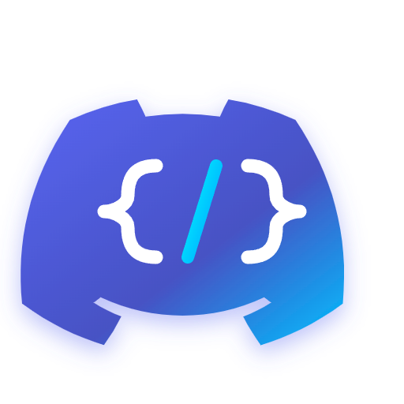
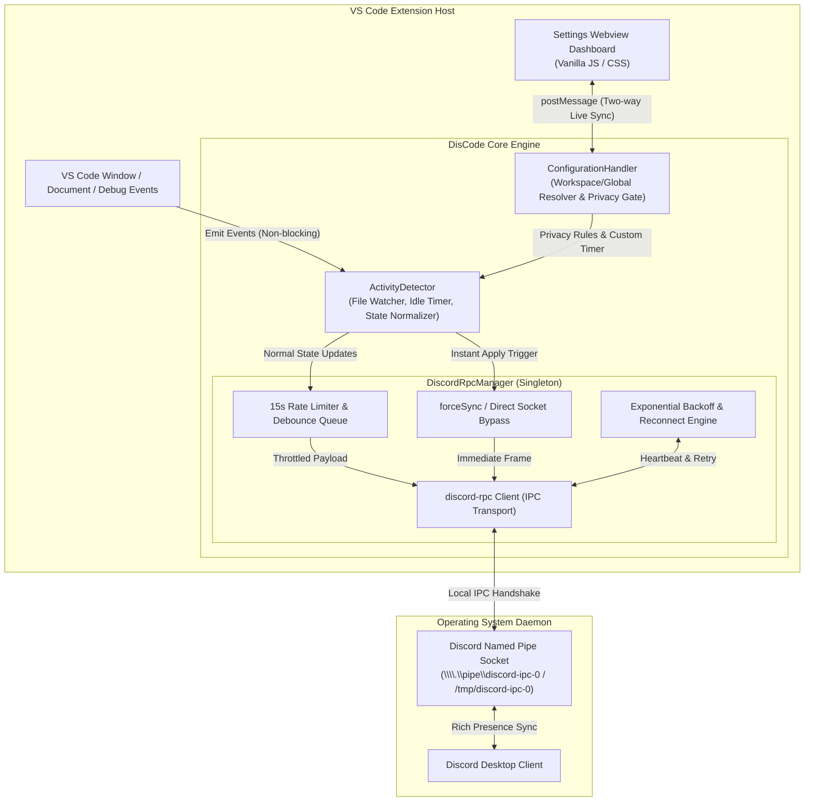

<div align="center">

  <a href="https://github.com/UnnamedPeople-Chin/discode">
    
  </a>

  # DisCode — Visual Discord Rich Presence

  <p align="center">
    <b>A high-performance, privacy-conscious Discord Rich Presence extension for VS Code with an interactive Live Preview dashboard, dynamic language branding, and instant synchronization.</b>
  </p>

  <p align="center">
    <a href="https://github.com/UnnamedPeople-Chin/discode/releases"></a>
    <a href="https://code.visualstudio.com"></a>
    <a href="https://www.typescriptlang.org"></a>
    <a href="https://discord.com"></a>
    <a href="./LICENSE"></a>
  </p>

  <p align="center">
    <a href="#-executive-summary">Executive Summary</a> •
    <a href="#-visual-previews">Visual Previews</a> •
    <a href="#-key-features">Key Features</a> •
    <a href="#-system-architecture--tech-stack">System Architecture</a> •
    <a href="#-project-directory-structure">Directory Structure</a> •
    <a href="#-getting-started--setup-guide">Getting Started</a> •
    <a href="#-team--credits">Team & Credits</a>
  </p>

</div>

---

## 📌 Executive Summary

Modern developers spend hours writing code across multiple projects, yet sharing real-time status on Discord is often hindered by legacy extensions suffering from **frequent IPC socket disconnects, unhandled memory leaks, and rigid configuration workflows**. Developers are typically forced to modify obscure `settings.json` keys blindly without knowing how their profile appears to peers.

**DisCode** solves this by establishing a rock-solid, production-grade integration between the **VS Code Extension API** and the **Discord Local RPC IPC socket**. Built with a centralized Singleton state orchestrator, exponential backoff reconnection, and an anti-leak disposal lifecycle, DisCode guarantees zero editor lag. Crucially, it introduces an **Interactive GUI Settings Dashboard with a Live Discord Profile Preview (`Ctrl + Alt + D`)**, dynamic language logo matching (React, TypeScript, Python, Go, Docker, etc.), granular elapsed timer controls, and sub-second instant synchronization without restarting your editor.

---

## 📸 Visual Previews

<table width="100%">
  <tr>
    <td width="50%" align="center" valign="top">
      
      <br />
      <em><b>Figure 1:</b> Interactive Settings Dashboard with Live Profile Preview (<code>Ctrl + Alt + D</code>)</em>
    </td>
    <td width="50%" align="center" valign="top">
      
      <br />
      <em><b>Figure 2:</b> Activity Customizer with Clickable Dynamic Variable Pills</em>
    </td>
  </tr>
  <tr>
    <td width="60%" align="center" valign="middle">
      
      <br />
      <em><b>Figure 3:</b> VS Code Editor Workspace with Integrated DisCode Status Bar</em>
    </td>
    <td width="40%" align="center" valign="middle">
      
      <br />
      <em><b>Figure 4:</b> Authentic Discord Profile Presence with File, Workspace & Elapsed Timer</em>
    </td>
  </tr>
</table>

---

## ✨ Key Features

### 🎨 1. GUI Settings Dashboard & Live Profile Card Preview
- **Interactive Webview (`Ctrl + Alt + D`):** Adjust all extension options through a sleek, Discord-styled visual dashboard without ever touching raw JSON configuration files.
- **Authentic Live Preview:** A real-time replica of the Discord user profile card sits alongside the configuration form, updating instantly as you type templates, toggle options, or change icon styles.
- **Clickable Variable Pills:** Click placeholder tags (`{fileName}`, `{language}`, `{workspace}`, `{gitBranch}`, `{currentLine}`) to automatically insert them into your status text.

### ⏱️ 2. Advanced Elapsed Timer Engine
- **Multiple Timer Modes:**
  - `session`: Accumulates continuously from the moment VS Code starts.
  - `file`: Automatically resets back to `00:00` upon switching active documents.
  - `manual`: Reset manually on demand via UI button or Command Palette.
- **Custom Duration Offset:** Manually specify elapsed hours and minutes (e.g. start immediately at *2 Hours 30 Minutes*) with quick preset buttons (`+1h`, `+2h`, `+3.5h`, `+5h`).
- **Instant Timer Apply:** Dedicated `⚡ Terapkan Waktu Saja` button updates Discord's time counter in <1 second.

### ⚡ 3. High-Performance IPC Engine & Instant Sync
- **Sub-Second Instant Sync:** Bypasses Discord's 15-second typing rate-limit buffer on manual apply, broadcasting changes directly to the IPC socket without editor or Discord restarts.
- **Exponential Backoff Reconnection:** If Discord closes or crashes, the client reconnects smoothly using $\min(60\text{s}, 5\text{s} \times 2^{\text{retry}}) + \text{jitter}(0-2\text{s})$, preventing CPU spikes and socket flooding.
- **Socket Error Trapping:** Internal transport-level socket listeners catch pipe disconnects cleanly, preventing crashes in the VS Code Extension Host.

### 📁 4. Context Detection & Privacy Control
- **Dynamic Language Branding:** File icons (React, TypeScript, Python, Rust, Go, Docker, HTML, CSS, SQL, etc.) dynamically take center stage as the large image asset.
- **Closing Behavior Choices:** Choose what happens when all tabs are closed: retain the last edited file, show workspace name only, switch to *Idling*, or clear activity completely.
- **Strict Privacy Controls:** Full toggles for masking file names, Git branch names, workspace directories, and blacklisting sensitive workspace folders.

---

## 🏗️ System Architecture & Tech Stack



### 🛠️ Technology Stack Breakdown

| Layer / Component | Technology | Purpose & Implementation Details |
| :--- | :--- | :--- |
| **Runtime Environment** | VS Code Extension API (`^1.85.0`) | Provides event subscriptions, Webview Panels, Commands, and Status Bar integration. |
| **Language & Engine** | TypeScript 5.3+ (Strict Mode) | Zero-any guarantee, memory-safe data structures, compiled to CommonJS Node.js target. |
| **IPC Communication** | `discord-rpc` (`^4.0.1`) | Native communication via Windows Named Pipes (`\\.\pipe\discord-ipc-0`) and Unix Domain Sockets. |
| **GUI Dashboard** | HTML5, CSS3, Vanilla JavaScript | Responsive two-column Webview panel with real-time state synchronization via `postMessage`. |
| **Package Format** | VS Code VSIX Package (`.vsix`) | Fully bundled, standalone distribution package (~976 KB) with zero global dependencies. |

---

## 📂 Project Directory Structure

```text
discode/
├── assets/
│   ├── icon.png                 # Transparent 512x512 extension mascot icon
│   ├── icon.svg                 # Scalable vector branding badge (transparent background)
│   └── screenshots/             # Production UI and live presence screenshots
│       ├── dashboard-preview.png # Settings modal & real-time profile card preview
│       ├── tokens-preview.png   # Activity customization with dynamic variable pills
│       ├── vscode-editor-view.png # Active VS Code editor with status bar integration
│       └── discord-profile-card.png # Authentic Discord Rich Presence profile card
├── src/
│   ├── extension.ts             # Extension activation lifecycle, commands & status bar registration
│   ├── activity/
│   │   └── ActivityDetector.ts  # State normalization, language icon resolver, and idle tracker
│   ├── config/
│   │   └── ConfigurationHandler.ts # Settings manager, privacy policy evaluator, and workspace overrides
│   ├── rpc/
│   │   └── DiscordRpcManager.ts # Singleton IPC connection, exponential backoff, and instant sync bypass
│   ├── ui/
│   │   └── SettingsWebviewPanel.ts # Responsive Webview GUI with real-time Discord Card Preview
│   └── test/
│       └── self-check.ts        # Self-contained verification suite for backoff & template invariants
├── .vscode/
│   ├── launch.json              # Clean extension debugging configuration (F5)
│   └── tasks.json               # Automated build & compilation tasks
├── package.json                 # Extension manifest, commands, keybindings, and settings schema
├── tsconfig.json                # TypeScript compiler configuration (ES2022 / CommonJS)
├── .vscodeignore                # Packaging filter for lean VSIX generation
├── LICENSE                      # MIT Open Source License
└── README.md                    # Project documentation
```

---

## 🚀 Getting Started & Setup Guide

### Prerequisites
- [Node.js](https://nodejs.org/) (version 18.0.0 or higher)
- [Visual Studio Code](https://code.visualstudio.com/) (version 1.85.0 or higher)
- [Discord Desktop Client](https://discord.com/) (installed, running, and logged in)

> [!IMPORTANT]
> Ensure **Display current activity as a status message** is enabled in your Discord settings under:  
> `User Settings` ➔ `Activity Privacy`.

---

### Method A: Quick Installation via VSIX Package (Recommended)

1. Download [`discode-1.3.0.vsix`](./discode-1.3.0.vsix) from the root directory or repository releases.
2. Open terminal and run:
   ```bash
   code --install-extension discode-1.3.0.vsix
   ```
3. *Alternative:* In VS Code, navigate to `Extensions` (`Ctrl + Shift + X`), click the top-right `...` menu, select **Install from VSIX...**, and choose the `.vsix` file.

---

### Method B: Local Development & Contribution Setup

1. **Clone the repository:**
   ```bash
   git clone https://github.com/UnnamedPeople-Chin/discode.git
   cd discode
   ```

2. **Install project dependencies:**
   ```bash
   npm install
   ```

3. **Compile TypeScript:**
   ```bash
   npm run compile
   ```

4. **Execute Self-Check Unit Tests:**
   ```bash
   npm test
   ```

5. **Launch Debugger:**
   Press **`F5`** in VS Code to open the isolated `[Extension Development Host]` window.

---

## ⌨️ Shortcuts & Commands

| Trigger | Action |
| :--- | :--- |
| **`Ctrl + Alt + D`** (macOS: `Cmd + Alt + D`) | Opens the **DisCode Settings Dashboard & Live Preview**. |
| **Status Bar Item** (Bottom right: `$(pulse) Discord: Connected`) | Shows live IPC status and opens settings on click. |
| **`Ctrl + Shift + P`** ➔ `Discord Presence: Reset Elapsed Timer` | Resets the elapsed coding counter back to `00:00`. |

---

## 👥 Team & Credits

- **Creator & Lead Developer:** [UnnamedPeople-Chin](https://github.com/UnnamedPeople-Chin)
- **Project Repository:** [https://github.com/UnnamedPeople-Chin/discode](https://github.com/UnnamedPeople-Chin/discode)
- **Issues & Feedback:** [GitHub Issue Tracker](https://github.com/UnnamedPeople-Chin/discode/issues)

---

## 📄 License

This project is licensed under the **MIT License** — see the [LICENSE](./LICENSE) file for complete details.
