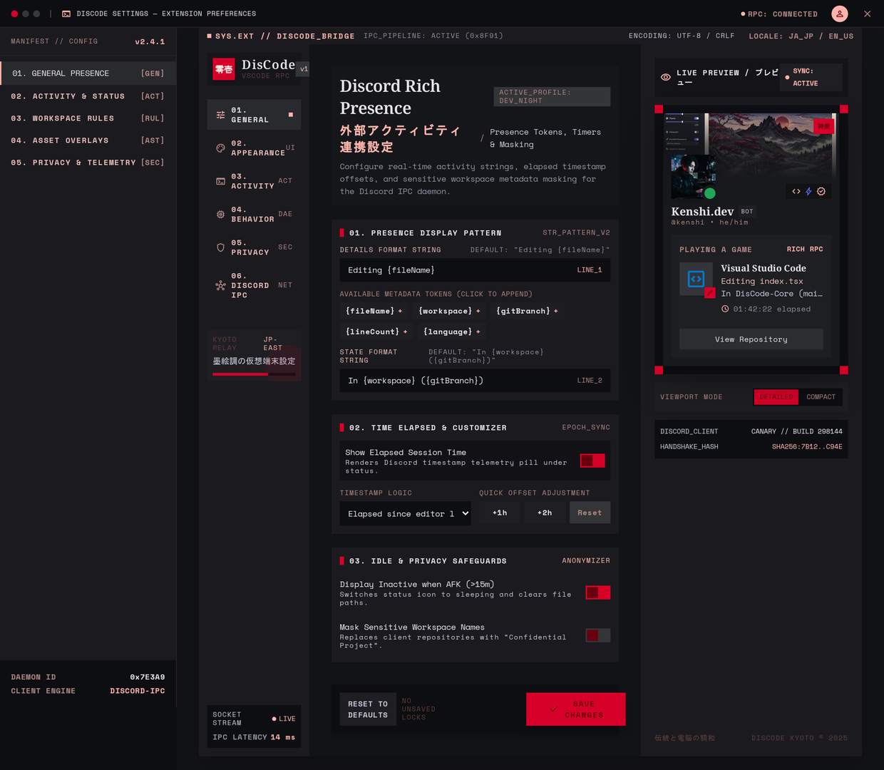
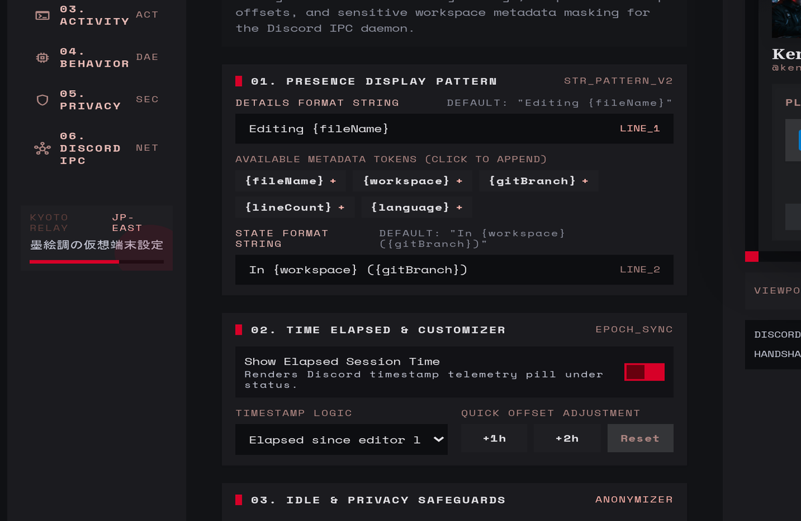
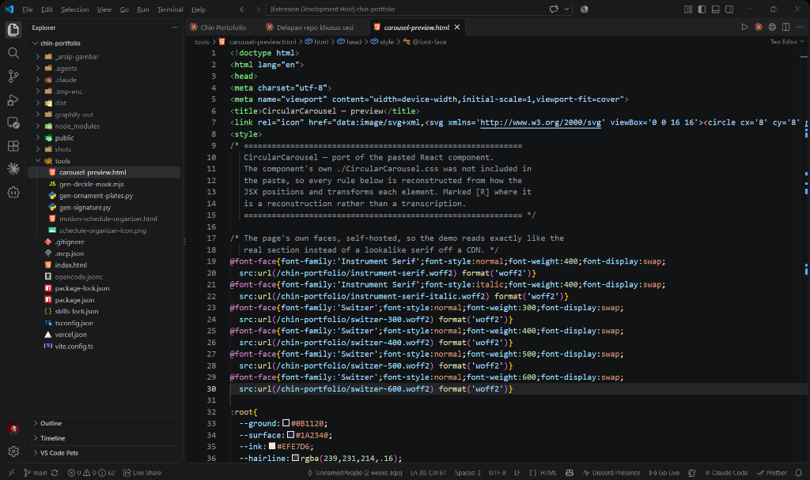
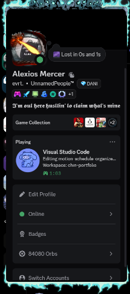

# DisCode - Visual Discord Rich Presence

A high-performance, privacy-conscious Discord Rich Presence extension for Visual Studio Code with an interactive Live Preview dashboard, dynamic language branding, and instant synchronization.

[](https://code.visualstudio.com)
[](https://www.typescriptlang.org)
[](https://discord.com)
[](https://github.com/UnnamedPeople-Chin/discode/blob/main/LICENSE)

---

## Executive Summary

DisCode establishes a robust, production-grade integration between the **VS Code Extension API** and the **Discord Local RPC IPC socket**. Built with a centralized Singleton state orchestrator, exponential backoff reconnection, and an anti-leak disposal lifecycle, DisCode guarantees zero editor lag. 

Key highlights include an **Interactive GUI Settings Dashboard with a Live Discord Profile Preview (`Ctrl + Alt + D`)**, dynamic language logo matching (React, TypeScript, Python, Go, Docker, etc.), granular elapsed timer controls, and sub-second instant synchronization without restarting your editor.

---

## Visual Previews

### 1. Cyber-Ronin Settings Dashboard & Live Profile Card Preview


### 2. Activity Customizer with Dynamic Variable Pills


### 3. VS Code Workspace with Integrated Status Bar


### 4. Authentic Discord Profile Presence


---

## Key Features

### 1. GUI Settings Dashboard & Live Profile Card Preview
- **Interactive Webview (`Ctrl + Alt + D`):** Adjust all extension options through a Discord-styled visual dashboard without modifying raw JSON configuration files.
- **Authentic Live Preview:** A real-time replica of the Discord user profile card sits alongside the configuration form, updating instantly as you edit templates, toggle options, or change icon styles.
- **Clickable Variable Pills:** Click placeholder tags (`{fileName}`, `{language}`, `{workspace}`, `{gitBranch}`, `{currentLine}`) to automatically insert them into your status text.

### 2. Advanced Elapsed Timer Engine
- **Multiple Timer Modes:**
  - `session`: Accumulates continuously from the moment VS Code opens.
  - `file`: Automatically resets back to `00:00` upon switching active documents.
  - `manual`: Reset manually on demand via UI button or Command Palette.
- **Custom Duration Offset:** Manually specify elapsed hours and minutes (e.g., start at *2 Hours 30 Minutes*) with preset buttons (`+1h`, `+2h`, `+3.5h`, `+5h`).
- **Instant Timer Apply:** Dedicated apply button updates Discord's elapsed time in less than a second.

### 3. High-Performance IPC Engine & Instant Sync
- **Sub-Second Instant Sync:** Bypasses Discord's 15-second typing rate-limit buffer on manual apply, broadcasting changes directly to the IPC socket without editor or Discord restarts.
- **Exponential Backoff Reconnection:** If Discord closes or crashes, the client reconnects smoothly using `min(60s, 5s * 2^retry) + jitter(0-2s)`, preventing CPU spikes and socket flooding.
- **Socket Error Trapping:** Internal transport-level socket listeners catch pipe disconnects cleanly, preventing crashes in the VS Code Extension Host.

### 4. Context Detection & Privacy Control
- **Dynamic Language Branding:** File icons (React, TypeScript, Python, Rust, Go, Docker, HTML, CSS, SQL, etc.) dynamically take center stage as the large image asset.
- **Closing Behavior Choices:** Choose what happens when all tabs are closed: retain the last edited file, show workspace name only, switch to *Idling*, or clear activity completely.
- **Strict Privacy Controls:** Full toggles for masking file names, Git branch names, workspace directories, and blacklisting sensitive workspace folders.

---

## System Architecture

```text
[VS Code Extension Host]
  |-- Window / Document / Debug Events ----> [ActivityDetector]
  |                                                  |
  |-- Settings Webview Dashboard <---------> [ConfigurationHandler]
                                                     |
[DisCode Core Engine]                                |
  |-- ActivityDetector ----> Rate Limiter & Debounce Queue
  |                               |                  |
  |-- Instant Sync Trigger ----> Bypass              |
  |                               |                  |
  |-- RPCManager (Singleton) <----+------------------+
            |
      (Local IPC Handshake)
            |
[OS Daemon / Discord Desktop Client]
  |-- Named Pipe / Socket: \\.\pipe\discord-ipc-0 or /tmp/discord-ipc-0
```

---

## Getting Started

### Installation

Install directly through the Visual Studio Code Extensions Marketplace:
1. Open VS Code.
2. Press `Ctrl + Shift + X` (macOS: `Cmd + Shift + X`) to open the Extensions view.
3. Search for **`DisCode`** (`discode-rpc`) published by **UnnamedPeople**.
4. Click **Install**.

Or install via terminal:
```bash
code --install-extension UnnamedPeople.discode-rpc
```

### Discord Setup
Ensure **Display current activity as a status message** is enabled in Discord under:  
`User Settings` -> `Activity Privacy`.

---

## Commands & Shortcuts

| Shortcut / Trigger | Action |
| :--- | :--- |
| **`Ctrl + Alt + D`** (macOS: `Cmd + Alt + D`) | Opens the **DisCode Settings Dashboard & Live Preview**. |
| **Status Bar Item** (`Discord: Connected`) | Displays live IPC status and opens settings on click. |
| **`Ctrl + Shift + P`** -> `Discord Presence: Reset Elapsed Timer` | Resets the elapsed coding counter back to `00:00`. |

---

## Team & Credits

- **Publisher:** [UnnamedPeople](https://github.com/UnnamedPeople-Chin)
- **Repository:** [https://github.com/UnnamedPeople-Chin/discode](https://github.com/UnnamedPeople-Chin/discode)
- **Issue Tracker:** [https://github.com/UnnamedPeople-Chin/discode/issues](https://github.com/UnnamedPeople-Chin/discode/issues)

---

## License

This project is licensed under the MIT License - see the [LICENSE](https://github.com/UnnamedPeople-Chin/discode/blob/main/LICENSE) file for details.
